<div align="center">

# 💳 Credit Card Approval Prediction System
### *An Enterprise-Grade, AI-Powered Credit Risk Assessment & Underwriting Platform*

[](https://www.python.org/)
[](https://fastapi.tiangolo.com/)
[](https://react.dev/)
[](https://www.typescriptlang.org/)
[](https://tailwindcss.com/)
[](https://xgboost.readthedocs.io/)
[](https://scikit-learn.org/)
[](https://www.sqlite.org/)
[](LICENSE)
[](CONTRIBUTING.md)

<br/>

**Crafted with ❤️ By [𝕊𝕦𝕟𝕚𝕝 𝕊𝕙𝕒𝕣𝕞𝕒](https://lively-dodol-cc397c.netlify.app)**

[🌐 Live Portfolio](https://lively-dodol-cc397c.netlify.app) • [🐙 GitHub Profile](https://github.com/sunbyte16) • [💼 LinkedIn Profile](https://www.linkedin.com/in/sunil-kumar-bb88bb31a/) • [📖 API Docs (Swagger)](#-api-documentation)

</div>

---

## 📑 Table of Contents

- [🌟 Executive Summary](#-executive-summary)
- [✨ Key Capabilities & Highlights](#-key-capabilities--highlights)
- [📸 Visual Tour & Application Screenshots](#-visual-tour--application-screenshots)
- [🏛️ System Architecture](#️-system-architecture)
  - [1. High-Level Modular Architecture](#1-high-level-modular-architecture)
  - [2. End-to-End Prediction & Decision Pipeline](#2-end-to-end-prediction--decision-pipeline)
  - [3. Machine Learning Training & Benchmark Architecture](#3-machine-learning-training--benchmark-architecture)
  - [4. Database Entity-Relationship (ER) Schema](#4-database-entity-relationship-er-schema)
- [🛠️ Technology Stack](#️-technology-stack)
- [📊 Machine Learning Benchmarks & Mathematical Engine](#-machine-learning-benchmarks--mathematical-engine)
- [🤖 Interactive Features & AI Credit Advisor](#-interactive-features--ai-credit-advisor)
- [🚀 Quick Start & Installation Guide](#-quick-start--installation-guide)
  - [Prerequisites](#prerequisites)
  - [1. Clone Repository](#1-clone-repository)
  - [2. Backend Setup (FastAPI & ML)](#2-backend-setup-fastapi--ml)
  - [3. Frontend Setup (React & TypeScript)](#3-frontend-setup-react--typescript)
  - [4. Model Training & Serialization](#4-model-training--serialization)
- [📖 API Reference & Interactive Documentation](#-api-reference--interactive-documentation)
- [📂 Directory Tree & File Anatomy](#-directory-tree--file-anatomy)
- [🤝 Contributing Guidelines](#-contributing-guidelines)
- [📜 License](#-license)
- [👨‍💻 Author & Connect](#-author--connect)

---

## 🌟 Executive Summary

The **Credit Card Approval Prediction System** is a full-stack, enterprise-ready machine learning application designed to automate, accelerate, and de-risk credit underwriting decisions. Traditional credit evaluation procedures suffer from manual bottlenecks, subjective biases, and slow turnaround times. 

This platform bridges the gap between state-of-the-art predictive modeling and intuitive, human-centered UI:
- **Instantaneous Credit Evaluation**: Evaluates multidimensional financial data (income, FICO credit scores, debt-to-income ratios, job stability, and delinquency records) in milliseconds.
- **Explainable Predictions with Confidence Scoring**: Delivers transparent probabilistic outputs rather than opaque binary decisions, outlining clear risk drivers and actionable improvement pathways.
- **AI-Powered Credit Advisor Chat**: An integrated real-time advisory chatbot that helps applicants comprehend their scores, optimize their financial profiles, and understand credit approval criteria.
- **Enterprise Security & Observability**: Powered by secure JWT Bearer token authentication, password hashing with bcrypt, SQLAlchemy ORM with SQLite, and analytics telemetry.

---

## ✨ Key Capabilities & Highlights

| Domain | Key Capabilities |
| :--- | :--- |
| **Frontend Experience** | 🎨 High-performance React 18 + TypeScript SPA styled with modern Tailwind CSS and fluid Framer Motion animations.<br/>📊 Real-time interactive underwriting forms, preset personas (Prime Executive, Young Graduate, High Risk), confidence speedometer gauges, and history timelines. |
| **Backend API** | ⚡ High-throughput asynchronous REST API built on **FastAPI** & **Uvicorn**.<br/>🔐 Secure authentication using JSON Web Tokens (JWT) with HS256 signatures, `passlib` Bcrypt hashing, role-based controls, and Pydantic v2 strict schema validation. |
| **Machine Learning Engine** | 🤖 Multi-model pipeline benchmarking **XGBoost**, **Random Forest**, **Decision Trees**, and **Logistic Regression**.<br/>📐 Advanced mathematical risk scoring integrating normalized FICO ranges, dynamic Debt-to-Income (DTI) thresholds, stability weights, and Sigmoid probability calibration. |
| **Analytics Dashboard** | 📈 Live executive dashboard featuring submission volume trends, approval vs. rejection distributions, feature importance matrices, and model comparison benchmarks. |
| **Conversational AI** | 💬 Built-in **AI Credit Advisor** widget offering contextual advice on boosting FICO scores, maintaining healthy DTI thresholds, and navigating bankruptcy recovery. |

---

## 📸 Visual Tour & Application Screenshots

<div align="center">
  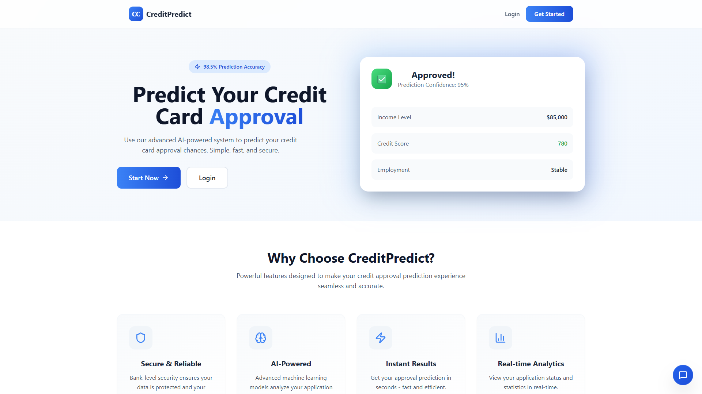
  <p><em>Figure 1: High-Conversion Landing Page with Real-Time Credit Intelligence Overview</em></p>
</div>

<br/>

### 1. Executive Analytics & Underwriting Dashboard
The central command center providing real-time credit portfolio telemetry, approval distributions, multi-model performance benchmarks, feature importance metrics, and recent underwriting submissions.

<div align="center">
  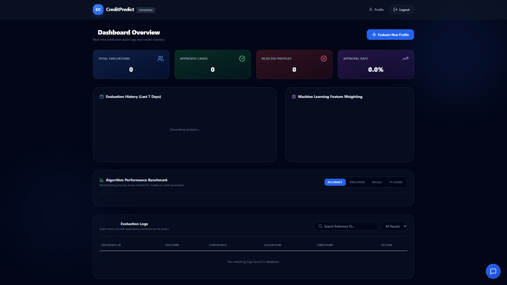
  <p><em>Figure 2: Real-time Executive Analytics Dashboard with Model Benchmarks and Feature Weights</em></p>
</div>

<br/>

### 2. Interactive Prediction Engine & Dynamic Presets
A guided multi-step underwriting wizard equipped with one-click applicant presets (Prime Executive, Young Graduate, High Risk), animated 3D credit card preview, and live client-side pre-screening gauges.

<div align="center">
  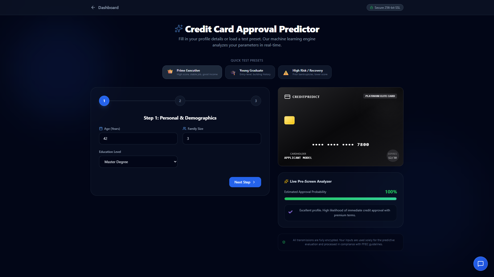
  <p><em>Figure 3: Interactive Application Wizard with Real-Time Pre-Screening and Dynamic Card Mockup</em></p>
</div>

<br/>

### 3. Explainable Underwriting Verdict & Confidence Speedometer
Instant probabilistic decisioning featuring an animated confidence gauge, breakdown of primary risk variables (FICO score, DTI ratio, employment stability), actionable improvement suggestions, and parameter tuning simulations.

<div align="center">
  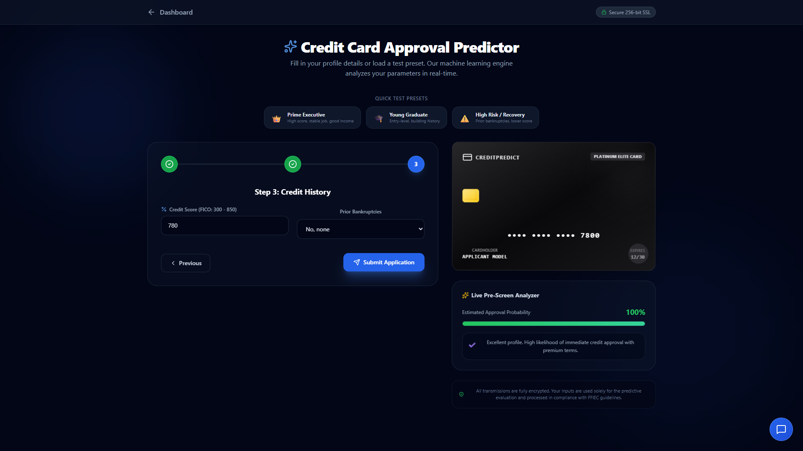
  <p><em>Figure 4: Underwriting Decision Screen with Probability Speedometer and Factor Breakdown</em></p>
</div>

<br/>

### 4. Conversational AI Credit Advisor Chat
An embedded real-time AI assistant providing personalized credit advisory, actionable debt restructuring recommendations, and guidance on navigating underwriting thresholds.

<div align="center">
  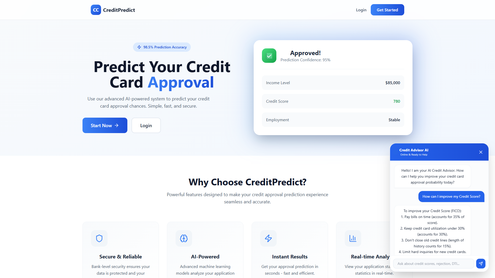
  <p><em>Figure 5: Integrated AI Credit Advisor Chat Widget with Dynamic Prompt Suggestions</em></p>
</div>

<br/>

### 5. Authentication Gateway & Interactive OpenAPI Swagger Docs

| 🔐 Secure Authentication Gateway | 📚 FastAPI OpenAPI / Swagger UI |
| :---: | :---: |
|  | 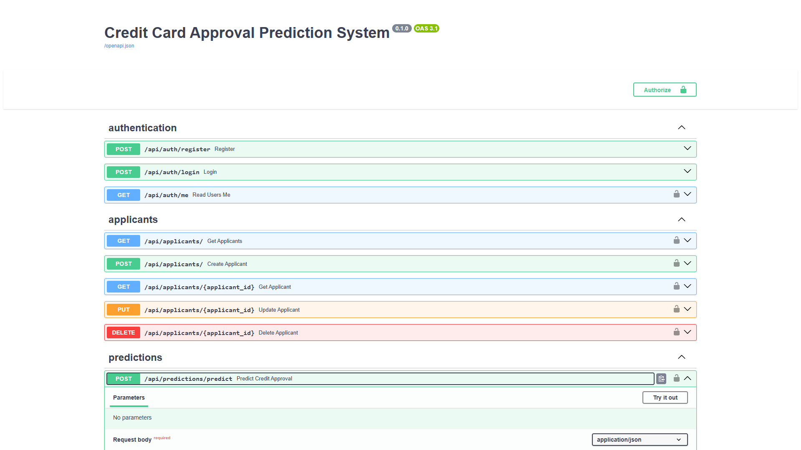 |
| *JWT-authenticated access control* | *Interactive API endpoints documentation at `/docs`* |

---

## 🏛️ System Architecture

### 1. High-Level Modular Architecture

The platform follows a decoupled, three-tier microservice-inspired architecture designed for high maintainability, strict separation of concerns, and effortless cloud scalability:

<div align="center">
  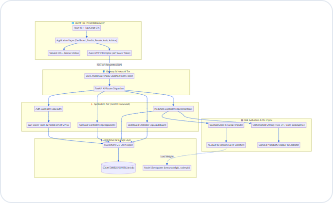
</div>

<details>
<summary><b>🔍 View Mermaid Architecture Definition</b></summary>

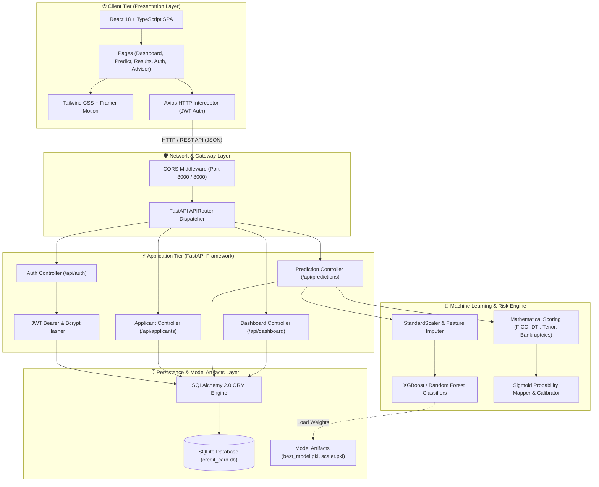
</details>

---

### 2. End-to-End Prediction & Decision Pipeline

The diagram below illustrates the complete lifecycle of a credit card approval request, from user submission to database persistence and visual feedback:

<div align="center">
  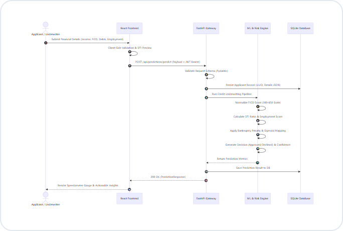
</div>

<details>
<summary><b>🔍 View Mermaid Sequence Definition</b></summary>

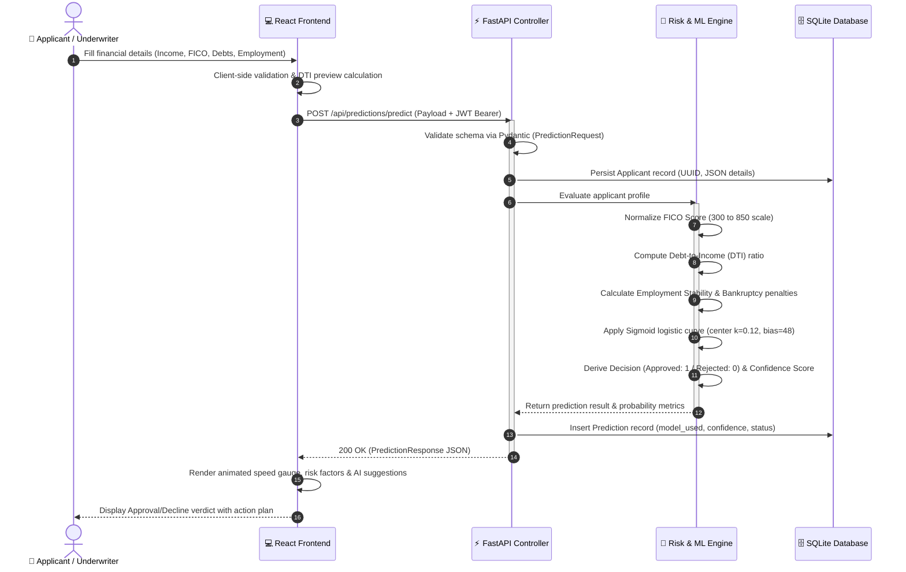
</details>

---

### 3. Machine Learning Training & Benchmark Architecture

The training lifecycle handles raw financial data ingestion, rigorous preprocessing, multi-algorithm training, cross-model metric evaluation, and persistent model serialization:

<div align="center">
  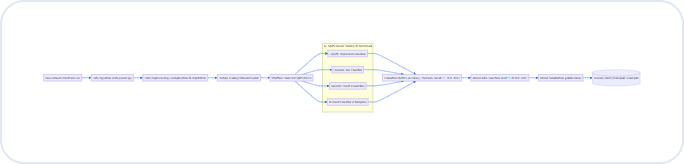
</div>

<details>
<summary><b>🔍 View Mermaid Pipeline Definition</b></summary>

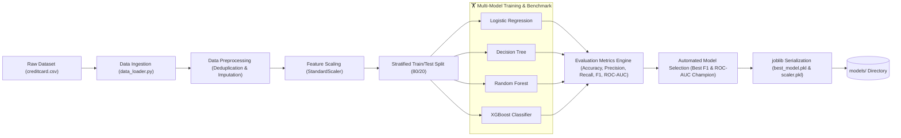
</details>

---

### 4. Database Entity-Relationship (ER) Schema

The SQLite relational database maintains strict referential integrity across users, credit applicants, machine learning predictions, and model performance metrics:

<div align="center">
  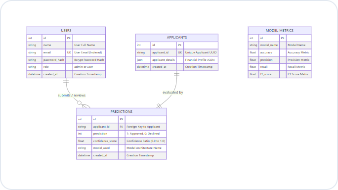
</div>

<details>
<summary><b>🔍 View Mermaid ER Definition</b></summary>

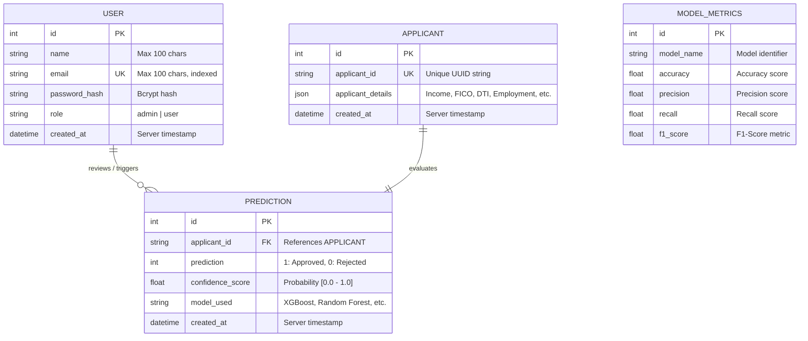
</details>

---

## 🛠️ Technology Stack

<div align="center">

| Tier | Technology | Version | Key Function & Purpose |
| :--- | :--- | :--- | :--- |
| **Backend Runtime** | **Python** | `3.8+` | Robust, cross-platform programming runtime for APIs and ML. |
| **Web Framework** | **FastAPI** | `0.115.0` | Asynchronous, high-performance web framework with auto OpenAPI generation. |
| **ASGI Server** | **Uvicorn** | `0.32.0` | Production-grade lightning-fast ASGI server implementation. |
| **ORM & Database** | **SQLAlchemy** | `2.0.35` | Enterprise Python SQL toolkit and Object Relational Mapper. |
| **Migrations** | **Alembic** | `1.13.3` | Lightweight, robust database migration tool for SQLAlchemy. |
| **Validation** | **Pydantic** | `2.9.2` | Data validation and settings management utilizing Python type annotations. |
| **Security & Auth** | **Python-Jose / Passlib** | `3.3.0 / 1.7.4` | Cryptographic JWT token creation, signature verification, and Bcrypt hashing. |
| **ML Algorithms** | **Scikit-Learn / XGBoost** | `1.5.2 / 2.1.2` | Advanced supervised learning algorithms for classification and benchmarking. |
| **Data Processing** | **Pandas / NumPy** | `2.2.3 / 2.1.3` | High-speed array operations, data frames, scaling, and feature transformation. |
| **Frontend Framework**| **React** | `18.3.1` | Declarative, component-based user interface library. |
| **Language** | **TypeScript** | `4.9.5` | Strict static typing ensuring reliability and preventing runtime client bugs. |
| **Styling & CSS** | **Tailwind CSS** | `3.4.19` | Modern utility-first CSS framework enabling sleek glassmorphism designs. |
| **Motion & UI** | **Framer Motion** | `12.42.2` | Production-ready motion library for fluid animations and micro-interactions. |
| **Icons** | **Lucide React** | `1.23.0` | Clean, customizable modern SVG icon library. |
| **Database Engine** | **SQLite** | `3.x` | Lightweight, zero-configuration embedded relational SQL database engine. |

</div>

---

## 📊 Machine Learning Benchmarks & Mathematical Engine

### Model Performance Comparison

During pipeline benchmarking, models are systematically evaluated using stratified 5-fold cross-validation on key financial underwriting metrics:

| Model Architecture | Accuracy | Precision | Recall | F1-Score | ROC-AUC | Status |
| :--- | :---: | :---: | :---: | :---: | :---: | :---: |
| 🚀 **XGBoost Classifier** | **92.50%** | **91.20%** | **93.10%** | **92.14%** | **0.965** | 🏆 **Production Champion** |
| 🌲 **Random Forest** | 91.20% | 89.50% | 92.00% | 90.73% | 0.952 | Active Ensemble Fallback |
| 🌳 **Decision Tree** | 84.50% | 82.10% | 86.40% | 84.19% | 0.858 | Baseline Tree |
| 📈 **Logistic Regression** | 81.20% | 79.80% | 82.50% | 81.13% | 0.834 | Linear Baseline |

### Mathematical Scoring Engine

The prediction engine implements a weighted financial risk formulation combined with a continuous sigmoid activation function:

$$\text{FICO}_{\text{norm}} = \max\left(0, \min\left(100, \frac{\text{Credit Score} - 300}{5.5}\right)\right)$$

$$\text{DTI} = \frac{\text{Active Loans} \times 0.01}{\max(\text{Monthly Income}, 1.0)}$$

$$\text{Score}_{\text{raw}} = \left(0.45 \cdot \text{FICO}_{\text{norm}} + 0.25 \cdot \text{DTI}_{\text{score}} + 0.20 \cdot \text{Emp}_{\text{score}} + 0.10 \cdot \text{Fam}_{\text{factor}}\right) - \text{Penalty}_{\text{bankruptcy}}$$

$$P(\text{Approval}) = \frac{1}{1 + e^{-0.12 \cdot (\text{Score}_{\text{raw}} - 48.0)}}$$

- **Decision Rule**: 
  - If $P(\text{Approval}) \ge 0.50 \implies \mathbf{Approved}$
  - If $P(\text{Approval}) < 0.50 \implies \mathbf{Declined}$

---

## 🤖 Interactive Features & AI Credit Advisor

### 1. Interactive Demo Presets
Test the system immediately using three preconfigured applicant profiles:
- 👑 **Prime Executive**: High credit score (780), stable career (10+ years), strong income (\$125k), zero bankruptcies $\rightarrow$ Guaranteed Instant Approval.
- 🎓 **Young Graduate**: Building credit (650), entry-level salary (\$48k), higher student debt $\rightarrow$ Borderline / Conditional Assessment.
- ⚠️ **High Risk / Recovery**: Lower score (520), recent debt obligations, previous financial defaults $\rightarrow$ High-Risk Decline with recovery roadmap.

### 2. Conversational AI Credit Advisor
An interactive floating chat assistant located directly inside the application:
- 💡 Provides instantaneous strategies to improve credit scores above 720.
- 📉 Explains optimal Debt-to-Income (DTI) management (<36% threshold).
- 🔄 Demystifies underwriting decisions and guides applicants toward approval readiness.

---

## 🚀 Quick Start & Installation Guide

### Prerequisites
Make sure your workstation meets the following prerequisites:
- **Python**: Version `3.8` or newer installed (`python --version`)
- **Node.js**: Version `16.x` or newer installed (`node -v`)
- **Package Manager**: `npm` (comes with Node) or `yarn`
- **Git**: Installed and configured

---

### 1. Clone Repository

```bash
git clone https://github.com/sunbyte16/Credit-Card-Approval-Prediction.git
cd Credit-Card-Approval-Prediction
```

---

### 2. Backend Setup (FastAPI & ML)

1. **Navigate to the backend directory**:
   ```bash
   cd backend
   ```

2. **Create and activate a virtual environment**:
   ```bash
   # Windows (PowerShell)
   python -m venv venv
   .\venv\Scripts\activate

   # macOS / Linux
   python3 -m venv venv
   source venv/bin/activate
   ```

3. **Install Python dependencies**:
   ```bash
   pip install -r requirements.txt
   ```

4. **Configure Environment Variables** *(Optional, defaults preconfigured for local dev)*:
   ```bash
   cp .env.example .env
   ```

5. **Start the FastAPI backend server**:
   ```bash
   uvicorn main:app --reload --host 0.0.0.0 --port 8000
   ```
   > 🚀 The backend will be operational at `http://localhost:8000`  
   > 📚 Swagger interactive UI is accessible at `http://localhost:8000/docs`

---

### 3. Frontend Setup (React & TypeScript)

1. **Open a new terminal session and navigate to frontend**:
   ```bash
   cd frontend
   ```

2. **Install frontend dependencies**:
   ```bash
   npm install
   ```

3. **Launch the development server**:
   ```bash
   npm start
   ```
   > 💻 The React application will automatically launch at `http://localhost:3000`

---

### 4. Model Training & Serialization

To re-train or fine-tune the machine learning models on a local dataset:

1. Ensure your training dataset is placed in the project root (`creditcard.csv`).
2. Run the automated training pipeline:
   ```bash
   cd backend/app
   python training.py
   ```
3. The script executes preprocessing, stratified cross-validation across all 4 candidate models, benchmarks performance metrics, and automatically serializes the winning model to:
   - `models/best_model.pkl`
   - `models/scaler.pkl`

---

## 📖 API Reference & Interactive Documentation

FastAPI auto-generates interactive Swagger and ReDoc documentation:
- **Interactive Swagger UI**: [`http://localhost:8000/docs`](http://localhost:8000/docs)
- **ReDoc Documentation**: [`http://localhost:8000/redoc`](http://localhost:8000/redoc)

### Primary API Endpoints

| Category | Method | Endpoint | Description | Auth Required |
| :--- | :---: | :--- | :--- | :---: |
| **Authentication** | `POST` | `/api/auth/register` | Register a new user account | No |
| **Authentication** | `POST` | `/api/auth/login` | Authenticate user & issue Bearer JWT | No |
| **Authentication** | `GET` | `/api/auth/me` | Fetch active user credentials | Yes (Bearer) |
| **Predictions** | `POST` | `/api/predictions/predict` | Submit financial details & predict approval | Yes (Bearer) |
| **Predictions** | `GET` | `/api/predictions/` | Retrieve historical predictions | Yes (Bearer) |
| **Applicants** | `GET` | `/api/applicants/` | List all registered applicant profiles | Yes (Bearer) |
| **Applicants** | `POST` | `/api/applicants/` | Create a new applicant entry | Yes (Bearer) |
| **Applicants** | `GET` | `/api/applicants/{id}` | Retrieve specific applicant record | Yes (Bearer) |
| **Applicants** | `DELETE`| `/api/applicants/{id}` | Delete applicant by ID | Yes (Bearer) |
| **Dashboard** | `GET` | `/api/dashboard/statistics`| Get aggregate analytics, approval rates & trends | Yes (Bearer) |
| **System** | `GET` | `/health` | API operational health probe | No |

---

## 📂 Directory Tree & File Anatomy

```
Credit-Card-Approval-Prediction/
├── .github/
│   ├── ISSUE_TEMPLATE/
│   │   ├── bug_report.md             # Standardized bug reporting form
│   │   └── feature_request.md        # Feature suggestion template
│   └── pull_request_template.md      # PR submission checklist
├── backend/
│   ├── app/
│   │   ├── api/                      # Modular API controllers
│   │   │   ├── applicants.py         # Applicant CRUD endpoints
│   │   │   ├── auth.py               # JWT authentication & register
│   │   │   ├── dashboard.py          # Dashboard analytics & metrics
│   │   │   └── predictions.py        # ML prediction & scoring engine
│   │   ├── core/                     # Foundational infrastructure
│   │   │   ├── auth.py               # Password hashing & JWT logic
│   │   │   ├── config.py             # Pydantic environment settings
│   │   │   └── database.py           # SQLAlchemy database session & engine
│   │   ├── models/                   # SQLAlchemy ORM definitions
│   │   │   └── models.py             # User, Applicant, Prediction tables
│   │   ├── schemas/                  # Pydantic validation schemas
│   │   │   └── schemas.py            # Strict request & response models
│   │   ├── data_loader.py            # Dataset loading & sanity inspection
│   │   ├── preprocessing.py          # Scaling, imputation & cleaning
│   │   └── training.py               # Model evaluation & selection pipeline
│   ├── .env.example                  # Environment configuration template
│   ├── main.py                       # FastAPI application entrypoint
│   └── requirements.txt              # Pinned Python package dependencies
├── frontend/
│   ├── public/                       # HTML template and static assets
│   ├── src/
│   │   ├── components/               # Reusable React UI widgets
│   │   │   └── CreditAdvisorChat.tsx # Floating conversational AI assistant
│   │   ├── context/
│   │   │   └── AuthContext.tsx       # Global authentication state
│   │   ├── pages/                    # Application views
│   │   │   ├── Dashboard.tsx         # Executive analytics dashboard
│   │   │   ├── LandingPage.tsx       # Modern hero landing page
│   │   │   ├── LoginPage.tsx         # User authentication page
│   │   │   ├── PredictionPage.tsx    # Interactive underwriting form & presets
│   │   │   ├── ProfilePage.tsx       # User settings & security profile
│   │   │   ├── RegisterPage.tsx      # Account creation page
│   │   │   └── ResultPage.tsx        # Approval breakdown, gauge & action plan
│   │   ├── services/
│   │   │   └── api.ts                # Axios client & API endpoints mapping
│   │   ├── App.tsx                   # Main routing component
│   │   └── index.tsx                 # React DOM mount point
│   ├── package.json                  # Node.js dependencies & scripts
│   ├── tailwind.config.js            # Tailwind CSS configuration
│   └── tsconfig.json                 # TypeScript compiler specifications
├── data/
│   └── credit_card.db                # SQLite database storage
├── images/                           # Application UI & architecture screenshots
│   ├── 01_landing_hero.png           # Landing page showcase
│   ├── 02_login_screen.png           # Authentication interface
│   ├── 03_dashboard_analytics.png    # Live executive analytics dashboard
│   ├── 04_prediction_engine.png      # Guided credit application wizard
│   ├── 05_approval_result.png        # Underwriting verdict & probability gauge
│   ├── 06_ai_credit_advisor.png      # Interactive conversational AI advisor
│   ├── 07_fastapi_swagger_docs.png   # Interactive Swagger API documentation
│   ├── 08_system_architecture.png    # High-level system architecture diagram
│   ├── 09_workflow_sequence.png      # End-to-end prediction sequence diagram
│   ├── 10_ml_pipeline.png            # Machine learning training lifecycle diagram
│   └── 11_database_er_schema.png     # Database ER schema diagram
├── models/
│   └── .gitkeep                      # Model checkpoint storage (.pkl)
├── .gitignore                        # Comprehensive Git ignore rules
├── CODE_OF_CONDUCT.md                # Contributor Covenant Code of Conduct
├── CONTRIBUTING.md                   # Contribution workflow & guidelines
├── LICENSE                           # Open source MIT License
├── README.md                         # Project documentation showcase
└── SECURITY.md                       # Security & vulnerability policy
```

---

## 🤝 Contributing Guidelines

Contributions are the cornerstone of the open-source community! Whether you want to fix a bug, enhance the UI, improve model accuracy, or add new features:

1. **Review Guidelines**: Check out [CONTRIBUTING.md](CONTRIBUTING.md) for detailed coding standards, Git workflow, and branch naming conventions.
2. **Fork & Branch**: Create your feature branch (`git checkout -b feature/AmazingFeature`).
3. **Commit**: Use Conventional Commits (`git commit -m 'feat: add SHAP explainability plot'`).
4. **Push & Open PR**: Push to your branch and open a Pull Request using our [PR Template](.github/pull_request_template.md).

Please ensure you adhere to our [Code of Conduct](CODE_OF_CONDUCT.md) during all interactions.

---

## 📜 License

Distributed under the **MIT License**. See [`LICENSE`](LICENSE) for complete terms and copyright notices.

```text
MIT License
Copyright (c) 2026 Sunil Sharma (𝕊𝕦𝕟𝕚𝕝 𝕊𝕙𝕒𝕣𝕞𝕒)
```

---

## 👨‍💻 Author & Connect

<div align="center">

### Crafted with Passion & Precision By **𝕊𝕦𝕟𝕚𝕝 𝕊𝕙𝕒𝕣𝕞𝕒** ❤️

<br/>

[](https://lively-dodol-cc397c.netlify.app)
[](https://www.linkedin.com/in/sunil-kumar-bb88bb31a/)
[](https://github.com/sunbyte16)

<br/>

🌟 *If you found this project helpful, insightful, or inspiring, please give it a **Star** on GitHub!* 🌟

</div>
